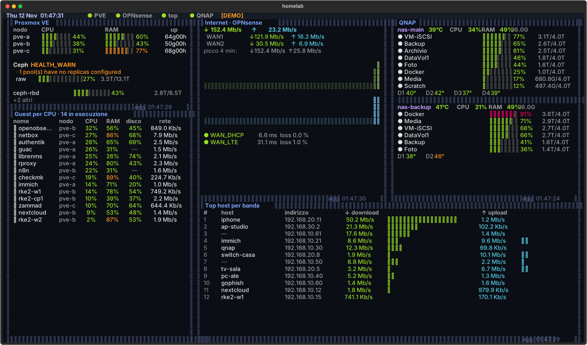

# homelab-tui-dash

Dashboard TUI a schermo intero, sempre accesa, per Proxmox VE, OPNsense e uno o più QNAP.
Pensata per un mini PC con un monitor 1366×768 (Dell E1609Wc) in modalità kiosk: `cage` + `foot` + Textual.



## Cosa mostra
| Pannello | Contenuto |
|---|---|
| **Proxmox VE** | CPU/RAM/uptime dei nodi, Ceph (opzionale), occupazione storage |
| **Guest per CPU** | VM/LXC in esecuzione ordinate per CPU, con RAM, disco e traffico di rete |
| **Internet · OPNsense** | Banda WAN in tempo reale (anche multi-WAN), sparkline, stato gateway |
| **QNAP** | Per ogni NAS: temperatura, CPU, RAM, volumi, temperatura e SMART dei dischi |
| **Top host per banda** | Host LAN con più traffico (download/upload) |

Le tabelle si adattano all'altezza dei pannelli. Quando i volumi QNAP non entrano, la dashboard mostra
prima quelli in errore e i più pieni e riassume gli altri. Un pannello con il bordo rosso è in errore
(il motivo è in basso a destra), uno giallo ha dati vecchi.

## Prova veloce
```bash
python3 -m venv .venv && .venv/bin/pip install -r requirements.txt
.venv/bin/python dashboard.py --demo
```

## Installazione kiosk (Ubuntu 24.04 / Debian 12+)
```bash
apt install -y cage foot fonts-jetbrains-mono snmp wlr-randr python3-venv
useradd -m -G video,render,input dash

git clone https://github.com/sysdumped/homelab-tui-dash /home/dash/homelab-dash
chown -R dash:dash /home/dash/homelab-dash
sudo -u dash python3 -m venv /home/dash/homelab-dash/.venv
sudo -u dash /home/dash/homelab-dash/.venv/bin/pip install -r /home/dash/homelab-dash/requirements.txt

install -d -o dash -g dash /home/dash/.config/homelab-dash /home/dash/.config/foot
install -m600 -o dash -g dash /home/dash/homelab-dash/config.example.toml /home/dash/.config/homelab-dash/config.toml
install -m644 -o dash -g dash /home/dash/homelab-dash/foot.ini /home/dash/.config/foot/foot.ini

cp /home/dash/homelab-dash/homelab-dash.service /etc/systemd/system/
systemctl daemon-reload && systemctl enable --now homelab-dash
```
Aggiungi `consoleblank=0` alla cmdline del kernel. Per spegnere il monitor di notte vedi `screen.sh`.

Il venv va creato **come utente `dash`** e nel percorso finale: un venv copiato da altrove ha il link
a `python` rotto e foot esce con codice 230.

## Configurazione
Parti da `config.example.toml`. Togli una sezione per nascondere quella sorgente.

- **PVE**: `ceph = true` solo se il cluster ha Ceph. `hide_storage` nasconde gli storage indicati.
  La colonna **disco** mostra il filesystem più pieno del guest: per gli LXC il dato arriva da PVE,
  per le VM serve `qemu-guest-agent` attivo nella VM. Senza agent compare `—`.
- **OPNsense**
  - `wan` accetta id interni o descrizioni, anche più WAN: `wan = ["wan1", "wan2"]`.
  - `top_interfaces` accetta **solo id interni** (`lan`, `opt1`…): con nomi sconosciuti l'API risponde `[]`.
    Per vedere gli id:
    ```bash
    curl -sk -u 'KEY:SECRET' https://FW/api/diagnostics/traffic/interface \
      | python3 -c "import sys,json; [print(k, v.get('name')) for k,v in json.load(sys.stdin)['interfaces'].items()]"
    ```
  - `[opnsense.names]` dà un nome agli IP senza reverse DNS.
- **QNAP**: un blocco `[[qnap]]` per NAS. `hide_volumes = ["..."]` nasconde i volumi indicati.

## Credenziali (sola lettura)
- **PVE**: utente `dashboard@pve` e token `tui`. Con privilege separation attiva (default) il ruolo
  `PVEAuditor` su `/` va dato **sia all'utente sia al token**, altrimenti l'API omette cpu/mem e la
  dashboard mostra 0%:
  ```bash
  pveum user add dashboard@pve
  pveum user token add dashboard@pve tui
  pveum acl modify / --users dashboard@pve --roles PVEAuditor
  pveum acl modify / --tokens 'dashboard@pve!tui' --roles PVEAuditor
  ```
  Se la colonna disco resta `—` anche per VM con l'agent attivo, al token manca il permesso di
  leggere il guest agent (`VM.GuestAgent.Audit` su PVE 9, `VM.Monitor` su PVE 8):
  ```bash
  pveum role add DashAgent -privs VM.GuestAgent.Audit      # PVE 8: -privs VM.Monitor
  pveum acl modify /vms --users dashboard@pve --roles DashAgent
  pveum acl modify /vms --tokens 'dashboard@pve!tui' --roles DashAgent
  ```
- **OPNsense**: utente dedicato con chiave API e privilegi *Diagnostics: Traffic* e *Status: Gateways*.
- **QNAP**: SNMP v1/v2 attivo (Pannello di controllo → Rete e servizi file → SNMP), community di sola
  lettura, UDP 161 aperta solo verso il mini PC. Verifica gli OID con
  `snmpwalk -v2c -c COMMUNITY IP 1.3.6.1.4.1.24681.1.2`.

## Troubleshooting
| Sintomo | Causa |
|---|---|
| `status=230/PERSONALITY` nel journal | Non è systemd: è foot che non riesce a partire (spesso il venv mancante). Gli errori sono nel journal grazie a `StandardError=journal`. |
| Warning `pam_lastlog.so` | Innocuo su Ubuntu 24.04 (modulo rimosso ma ancora citato in `/etc/pam.d/login`). |
| PVE con CPU/RAM a 0% | Token senza `Sys.Audit`: vedi Credenziali. |
| Pannello top host vuoto o in errore | `top_interfaces` con nomi invece che id interni. |
| Volumi QNAP mancanti | OID diversi sulla tua versione di QTS: controlla `.17.1.*` con `snmpwalk`. |
